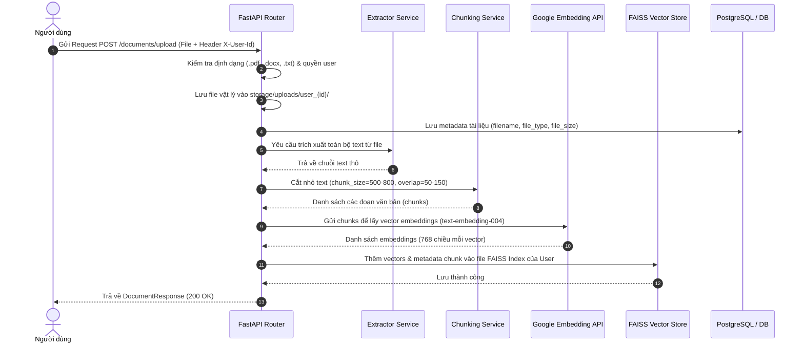
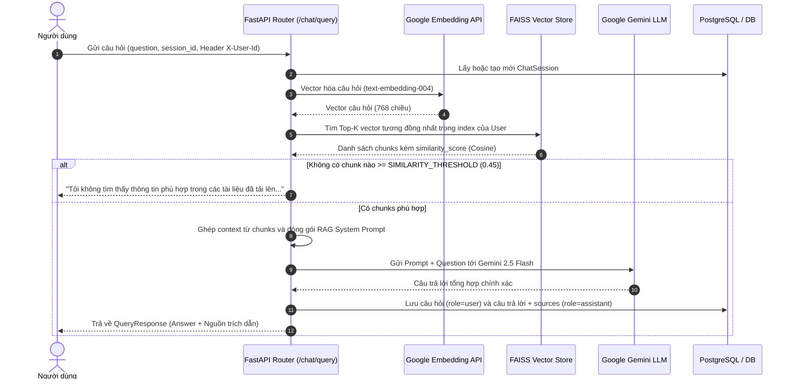
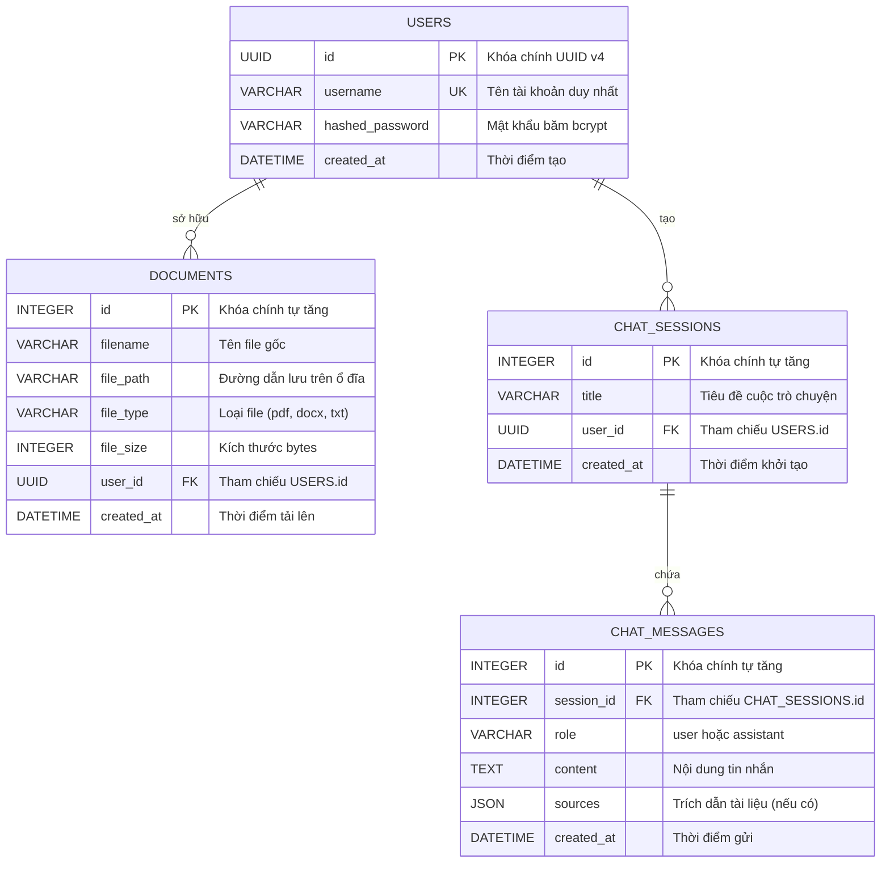

# TÀI LIỆU ĐẶC TẢ YÊU CẦU NGHIỆP VỤ (BUSINESS REQUIREMENTS DOCUMENT - BRD / BA)
## DỰ ÁN: HỆ THỐNG RAG QUẢN LÝ & HỎI ĐÁP TÀI LIỆU THÔNG MINH

---

## 1. TỔNG QUAN DỰ ÁN (PROJECT OVERVIEW)

### 1.1 Bối cảnh & Vấn đề (Problem Statement)
- Người dùng thường xuyên phải xử lý lượng tài liệu lớn ở nhiều định dạng (`PDF`, `DOCX`, `TXT`).
- Việc tìm kiếm thủ công mất nhiều thời gian và khó tổng hợp thông tin chính xác từ nhiều trang hoặc nhiều tài liệu.
- Các mô hình AI thông thường có thể bị "bịa đặt" (hallucination) nếu không được cung cấp ngữ cảnh thực tế từ tài liệu của doanh nghiệp/người dùng.

### 1.2 Mục tiêu của hệ thống (Project Objectives)
- Xây dựng hệ thống **RAG (Retrieval-Augmented Generation)** độc lập, bảo mật theo từng người dùng.
- Cho phép người dùng tải lên tài liệu, tự động phân tích trích xuất, băm nhỏ (chunking), vector hóa và lưu vào Vector Database (FAISS).
- Cung cấp tính năng hỏi đáp dựa trên tài liệu: Trả lời chính xác, kèm nguồn trích dẫn (citations) và **tuyệt đối không bịa đặt** nếu tài liệu không có thông tin.
- Quản lý phiên làm việc, lịch sử hỏi đáp và quản trị tài liệu tải lên.

---

## 2. PHÂN TÍCH TÁC NHÂN (ACTORS & ROLES)

| Tác nhân (Actor) | Mô tả vai trò |
| :--- | :--- |
| **Guest (Khách)** | Người dùng chưa đăng ký, có thể đăng ký tài khoản hoặc đăng nhập. |
| **Authenticated User** | Người dùng đã đăng ký, sở hữu không gian lưu trữ tài liệu riêng, thực hiện upload tài liệu, xóa tài liệu, tạo phiên chat và đặt câu hỏi. |
| **System / RAG Engine** | Thành phần nền tảng thực hiện trích xuất text, sinh embedding, tìm kiếm vector tương đồng trên FAISS và gọi Gemini LLM để tổng hợp câu trả lời. |

---

## 3. DANH SÁCH USE CASE & MA TRẬN PHÂN QUYỀN

```mermaid
usecaseDiagram
    actor "Người dùng (User)" as user
    actor "Hệ thống RAG (Engine)" as system

    package "Module Xác thực (Auth)" {
        usecase "UC01: Đăng ký tài khoản" as UC01
        usecase "UC02: Đăng nhập" as UC02
        usecase "UC03: Lấy thông tin cá nhân" as UC03
    }

    package "Module Quản lý tài liệu (Documents)" {
        usecase "UC04: Tải lên tài liệu (PDF/DOCX/TXT)" as UC04
        usecase "UC05: Xem danh sách tài liệu" as UC05
        usecase "UC06: Xóa tài liệu & xóa vector index" as UC06
    }

    package "Module Hỏi đáp RAG (Chat & Q&A)" {
        usecase "UC07: Đặt câu hỏi theo ngữ cảnh tài liệu" as UC07
        usecase "UC08: Nhận phản hồi kèm trích dẫn nguồn" as UC08
        usecase "UC09: Xử lý không tìm thấy thông tin" as UC09
        usecase "UC10: Lưu & xem lịch sử chat" as UC10
    }

    user --> UC01
    user --> UC02
    user --> UC03
    user --> UC04
    user --> UC05
    user --> UC06
    user --> UC07
    user --> UC10

    UC04 ..> system : "Kích hoạt Pipeline Ingestion"
    UC07 ..> system : "Kích hoạt Pipeline Retrieval + LLM"
    system --> UC08
    system --> UC09
```

---

## 4. QUY TRÌNH NGHIỆP VỤ CHI TIẾT (BUSINESS PROCESS FLOWS)

### 4.1 Quy trình Nạp tài liệu (Document Ingestion Pipeline)



### 4.2 Quy trình Hỏi đáp RAG (Query & Retrieval Pipeline)



---

## 5. QUY TẮC NGHIỆP VỤ (BUSINESS RULES)

1. **BR-01 (Định dạng hỗ trợ):** Chỉ chấp nhận các định dạng `.pdf`, `.docx`, `.txt`. Các định dạng khác trả về mã lỗi HTTP 400.
2. **BR-02 (Phân lập dữ liệu người dùng):** Mỗi người dùng sở hữu một chỉ mục FAISS độc lập (`user_{uuid}.index`). Người dùng A không thể truy vấn hoặc xem tài liệu của Người dùng B.
3. **BR-03 (Chống Bịa đặt - Anti-Hallucination):** 
   - Nếu không có chunk nào đạt ngưỡng tương đồng (`score >= SIMILARITY_THRESHOLD`), hệ thống trả về thông báo tiêu chuẩn: *"Tôi không tìm thấy thông tin phù hợp trong các tài liệu đã tải lên để trả lời câu hỏi này."*
   - LLM bắt buộc phải tuân theo System Prompt: Chỉ trả lời dựa trên ngữ cảnh được cung cấp.
4. **BR-04 (Tính toàn vẹn khi xóa tài liệu):** Khi xóa 1 tài liệu:
   - Xóa bản ghi trong SQL Database.
   - Xóa file vật lý trên đĩa cứng.
   - Loại bỏ tất cả vector tương ứng của tài liệu đó ra khỏi FAISS Index.
5. **BR-05 (Minh bạch nguồn thông tin):** Mọi câu trả lời được sinh từ RAG đều phải đính kèm danh sách trích dẫn (tên file, đoạn văn trích dẫn, điểm tương đồng).

---

## 6. THIẾT KẾ CƠ SỞ DỮ LIỆU (DATABASE DESIGN & ERD)



---

## 7. ĐẶC TẢ GIAO DIỆN API (API CONTRACTS)

### 7.1 Nhóm Xác thực (`/api/v1/auth`)
- `POST /register`: Tạo tài khoản mới. Body: `{ "username": "...", "password": "..." }`.
- `POST /login`: Kiểm tra mật khẩu và trả về thông tin User.
- `GET /me`: Lấy thông tin user hiện tại qua Header `X-User-Id: <UUID>`.

### 7.2 Nhóm Quản lý tài liệu (`/api/v1/documents`)
- `POST /upload`: Multipart form-data upload file (`.pdf`, `.docx`, `.txt`). Yêu cầu Header `X-User-Id`.
- `GET /`: Danh sách tài liệu của user hiện tại.
- `DELETE /{document_id}`: Xóa tài liệu, xóa file và gỡ bỏ vector trong FAISS.

### 7.3 Nhóm Hỏi đáp RAG (`/api/v1/chat`)
- `POST /query`: Gửi câu hỏi. Body: `{ "question": "...", "session_id": 1 | null }`. Yêu cầu Header `X-User-Id`. Trả về câu trả lời và mảng `sources`.

---

## 8. TIÊU CHÍ NGHIỆM THU (ACCEPTANCE CRITERIA)

| Mã tiêu chí | Điều kiện kiểm thử | Kết quả mong đợi |
| :--- | :--- | :--- |
| **AC-01** | Upload file `.pdf` 10 trang có nội dung về chính sách công ty. | File được lưu, cắt thành các chunks, FAISS index được tạo và trả về mã HTTP 200. |
| **AC-02** | Hỏi câu hỏi có trong tài liệu vừa tải lên (ví dụ: "Thời gian làm việc quy định thế nào?"). | Nhận được câu trả lời chính xác, đúng trọng tâm và danh sách `sources` chỉ rõ trích từ file vừa upload. |
| **AC-03** | Hỏi câu hỏi hoàn toàn không có trong tài liệu (ví dụ: "Thời tiết hôm nay tại Tokyo ra sao?"). | Hệ thống trả lời đúng câu tiêu chuẩn: *"Tôi không tìm thấy thông tin phù hợp trong các tài liệu đã tải lên để trả lời câu hỏi này."*, danh sách `sources` rỗng. |
| **AC-04** | Xóa tài liệu vừa tải lên và hỏi lại câu hỏi cũ. | Hệ thống thông báo không tìm thấy thông tin (do vector đã được gỡ khỏi FAISS). |
| **AC-05** | Người dùng A đặt câu hỏi về tài liệu của Người dùng B. | Hệ thống báo không tìm thấy thông tin (đảm bảo tính bảo mật riêng biệt). |
